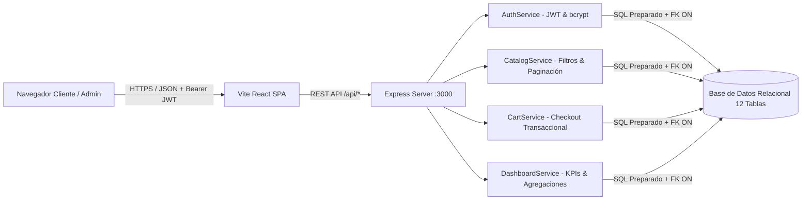

# ELECTROTECH — Documentación Técnica, Arquitectura y QA

## 1. Estructura de Carpetas

```text
electrotech/
├── docs/
│   ├── ARQUITECTURA_Y_ENTREGABLES.md
│   └── database_mysql8.sql
├── shared/
│   └── types.ts                  # Contratos TypeScript compartidos Frontend/Backend
├── server/
│   ├── db.ts                     # Esquema relacional (12 tablas) y semilla SQLite
│   ├── routes/
│   │   └── api.ts                # Enrutador modular Express REST (/api/*)
│   └── services/
│       ├── authService.ts        # Autenticación JWT, bcrypt, roles y recuperación
│       ├── catalogService.ts     # Búsqueda, filtros, ordenamiento y paginación
│       ├── cartService.ts        # Carrito, validación de stock y checkout transaccional
│       └── dashboardService.ts   # Indicadores KPI y analítica en tiempo real
├── src/
│   ├── assets/images/            # Fotografía de hardware generada localmente
│   ├── components/
│   │   ├── Navbar.tsx            # Barra de navegación de 3 zonas
│   │   ├── WelcomePage.tsx       # Módulo 01: Pantalla de bienvenida futurista
│   │   ├── LoginPage.tsx         # Módulo 02: Login, registro, recuperación y RBAC
│   │   ├── DashboardPage.tsx     # Módulo 03: Panel administrativo con Chart.js
│   │   ├── CatalogPage.tsx       # Módulo 04: Catálogo con 9 categorías y filtros
│   │   ├── ProductDetailModal.tsx# Detalle técnico y módulo de compra contiguo
│   │   ├── CartPage.tsx          # Módulo 05: Carrito de compras y confirmación
│   │   ├── ProductImage.tsx      # Imagen resiliente con respaldo visual
│   │   └── Footer.tsx            # Módulo 06: Pie de página corporativo
│   ├── services/api.ts           # Cliente HTTP tipado
│   ├── App.tsx                   # Orquestador de vistas y estado global
│   └── index.css                 # Tokens Tailwind v4 y estilos Glassmorphism
├── tests/                        # Suite de pruebas automatizadas (principios FIRST)
│   ├── testHelper.ts
│   ├── welcome.test.ts
│   ├── auth.test.ts
│   ├── dashboard.test.ts
│   ├── catalog.test.ts
│   ├── cart.test.ts
│   └── footer.test.ts
├── server.ts                     # Servidor Express + Vite en puerto 3000
├── vitest.config.ts              # Configuración Vitest + cobertura V8
└── package.json
```

## 2. Diagrama de Arquitectura



## 3. Modelo Entidad-Relación (12 Tablas)

- `roles (1) ──< (N) usuarios`
- `usuarios (1) ── (1) clientes`
- `categorias (1) ──< (N) productos`
- `marcas (1) ──< (N) productos`
- `productos (1) ── (1) inventario`
- `usuarios (1) ──< (N) carritos`
- `carritos (1) ──< (N) carrito_detalles >── (1) productos`
- `usuarios / clientes (1) ──< (N) pedidos`
- `pedidos (1) ──< (N) pedido_detalles >── (1) productos`
- `pedidos (1) ── (1) pagos`

## 4. Manual de Instalación

1. Instalar dependencias:
   `npm install`
2. Ejecutar pruebas unitarias y de integración con cobertura:
   `npm run test:coverage`
3. Compilar la aplicación para producción:
   `npm run build`
4. Iniciar el servidor unificado (Express + Vite en puerto 3000):
   `npm run dev`

## 5. Manual de Usuario

- **Administrador (`admin@electrotech.pe` / `Admin2026!`)**: Ingresa directamente al Dashboard Administrativo con KPIs en tiempo real, gráficos Chart.js, gestión de pedidos, reposición de inventario y registro de nuevos artefactos.
- **Cliente (`cliente@electrotech.pe` / `Cliente2026!`)**: Explora las 9 categorías del catálogo, consulta detalles técnicos, gestiona cantidades en el carrito (con validación automática de stock) y confirma pedidos con comprobante inmediato.
