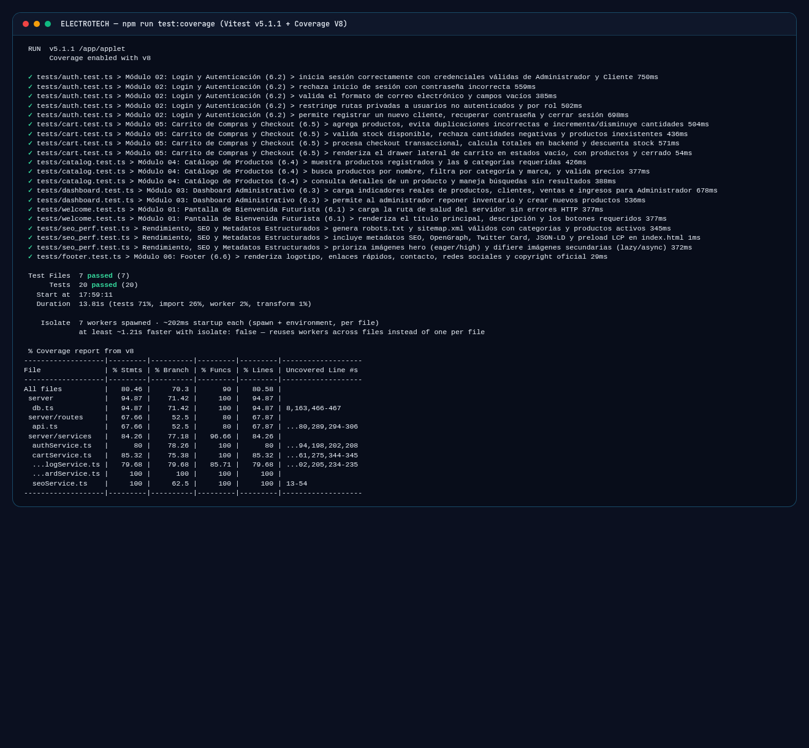
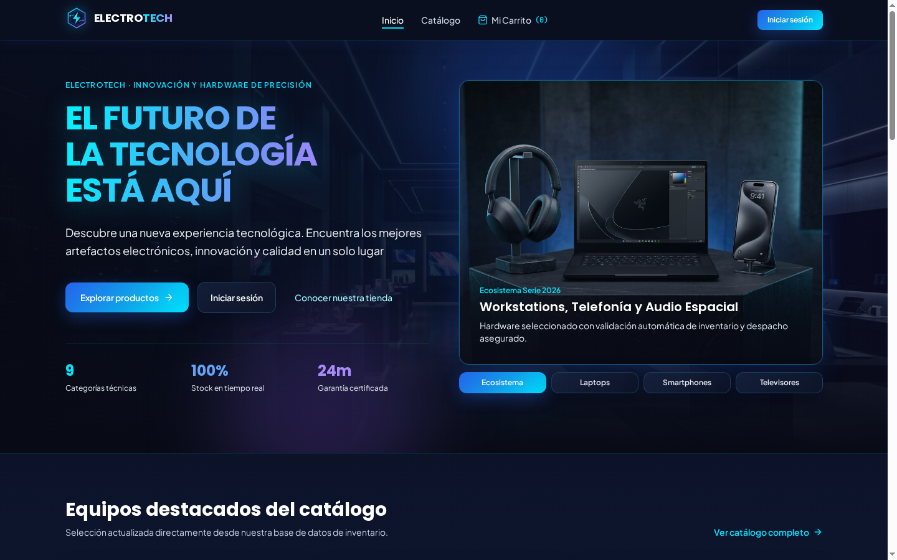
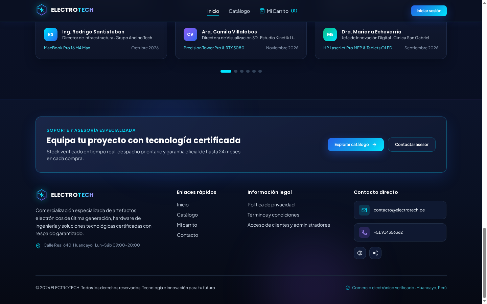
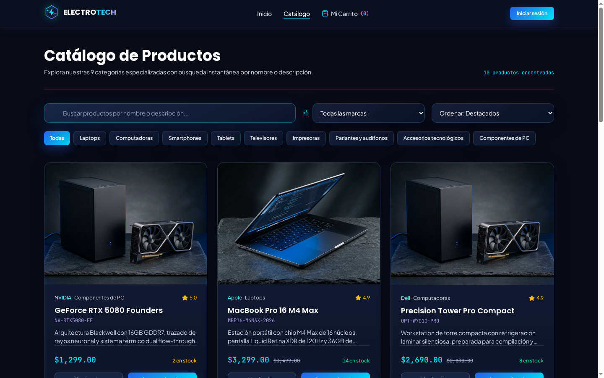
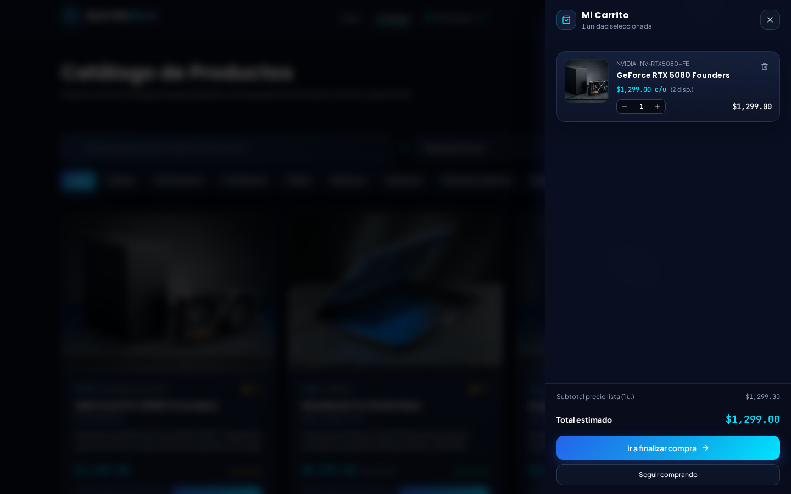
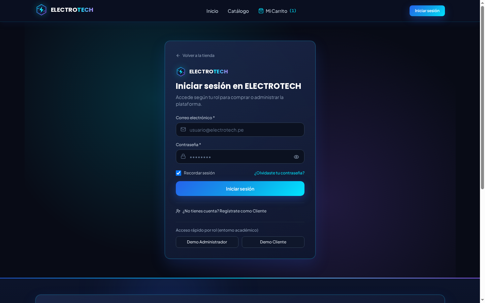
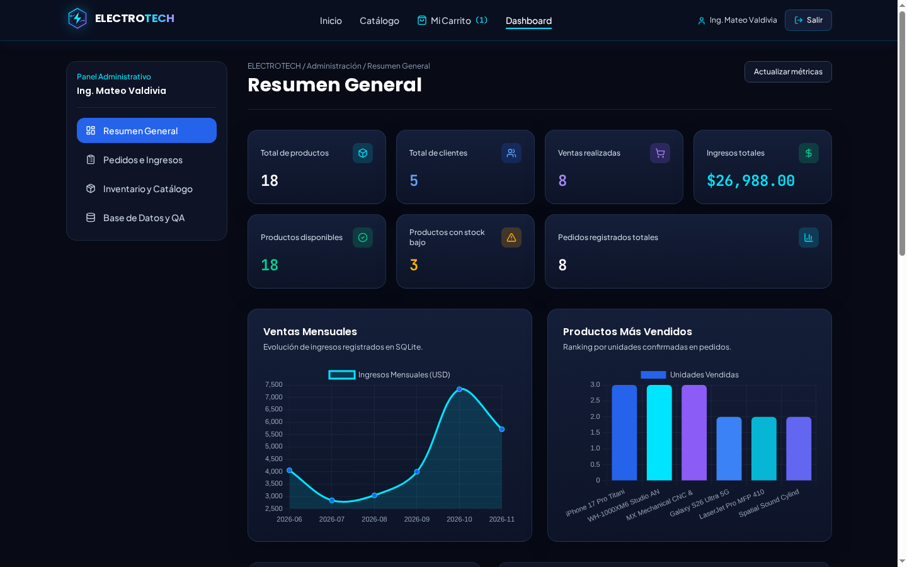

# Plan de Pruebas - ELECTROTECH - [Tu Apellido y Nombre]

> **Instrucciones de uso en Confluence:**
> 1. Ingresa a tu espacio de trabajo en Confluence y haz clic en **`+` (Crear página)** junto a *Páginas*.
> 2. Coloca como título exacto: **`Plan de Pruebas - ELECTROTECH - [Tu Apellido y Nombre]`**.
> 3. Copia y pega el contenido estructurado de las secciones **1 a 6** (encabezados, tablas y bloques de código `/code`), inserta tus macros `/jira` donde se indica y pega las imágenes de `docs/screenshots/`.
> 4. Haz clic en **Publicar** → **Compartir** (habilita acceso de lectura) y copia el enlace para tu entrega final.

---

## 1. Objetivo y Alcance

### 1.1 Objetivo
Validar de manera integral la calidad funcional, seguridad por roles, integridad transaccional, rendimiento de carga y optimización SEO del sistema web de comercio electrónico **ELECTROTECH** (comercialización de artefactos electrónicos), conforme a los lineamientos de documentación de pruebas basados en el estándar **ISO/IEC/IEEE 29119**.

### 1.2 Alcance (En alcance / In-Scope)
Se validan los **6 módulos principales** y la capa técnica transversal de ELECTROTECH:
- **Módulo 01 — Pantalla de Bienvenida y Navegación:** Disponibilidad del servidor (`/api/health`), renderizado del hero futurista, logotipo hexagonal, escaparate 3D interactivo y carrusel de testimonios.
- **Módulo 02 — Login, Registro y RBAC:** Autenticación con JWT + `bcrypt`, validación de campos vacíos y formato de correo, recuperación de contraseña, registro de clientes, cierre de sesión y control de acceso por roles (`Administrador` vs `Cliente`).
- **Módulo 03 — Dashboard Administrativo:** Consulta en tiempo real de los 7 KPIs reales desde base de datos (`18` productos, `5` clientes, `8` ventas, ingresos totales, `3` alertas de stock bajo), gráficos Chart.js, reposición de inventario y registro de nuevos artefactos.
- **Módulo 04 — Catálogo de Productos:** Listado de `18` productos y `9` categorías, búsqueda instantánea por nombre o descripción, filtros por categoría y marca, precios promocionales y ficha técnica modal.
- **Módulo 05 — Carrito de Compras, Drawer Lateral y Checkout:** Consolidación de productos sin duplicados, incremento/disminución/eliminación, estado cerrado/vacío/poblado del drawer lateral, validación de stock en backend y checkout transaccional ACID con descuento real de inventario.
- **Módulo 06 — Footer, SEO y Rendimiento:** Datos de sede en Huancayo (`Calle Real 640, Huancayo`), teléfono `+51 914356362`, enlaces legales, endpoints `/robots.txt` y `/sitemap.xml`, JSON-LD (`Store`, `WebSite`, `Product`), code splitting y prioridad de carga de imágenes (`eager` / `lazy`).

### 1.3 Fuera de Alcance (Out-of-Scope)
- Integración con pasarelas de pago bancarias reales de producción (los pagos se registran y aprueban mediante simulación transaccional controlada en backend).
- Rastreo GPS en vivo con operadores logísticos o couriers externos.
- Pruebas de carga y estrés masivo superiores a 1,000 usuarios simultáneos.
- Pruebas físicas en dispositivos móviles reales (se valida responsividad en viewport de escritorio y pruebas automatizadas de servidor/SSR).

---

## 2. Estrategia y Entorno

### 2.1 Entorno de Pruebas y Herramientas

| Componente | Especificación Real Utilizada en ELECTROTECH |
| :--- | :--- |
| **Sistema Operativo** | Linux (contenedor de ejecución) / Compatible con Windows 10/11 |
| **IDE / Editor** | Visual Studio Code + TypeScript (`tsc --noEmit`) |
| **Runtime y Backend** | Node.js v22 + Express 4 (`tsx server.ts` en puerto `3000`) |
| **Base de Datos** | SQLite relacional (`node:sqlite`, `:memory:` aislado por prueba, `PRAGMA foreign_keys = ON`, 12 tablas) |
| **Frontend** | React 19 + Vite 8 + Tailwind CSS v4 + Chart.js + Motion |
| **Framework de Pruebas** | **Vitest v5.1.1** + **`@vitest/coverage-v8`** + `react-dom/server` (`renderToStaticMarkup`) |
| **Navegador de Evidencia** | Google Chrome for Testing / Chromium Headless (`1440×900`) |

### 2.2 Enfoque Metodológico
- **Pruebas Funcionales Automatizadas de Caja Negra:** Validación de entradas, códigos HTTP (`200`, `201`, `400`, `401`, `403`, `404`, `409`) y respuestas JSON sobre los endpoints REST `/api/*`.
- **Análisis de Valores Límite (Boundary Value Analysis):** Verificación de cantidades negativas (`-2`, `-5`), stock mínimo (`2` unidades en *GeForce RTX 5080 Founders*), exceso de inventario (`99` unidades) e identificadores inexistentes (`9999`, `99999`).
- **Partición de Equivalencia por Roles:** Comparación sistemática de permisos entre usuario anónimo, rol `Cliente` y rol `Administrador`.
- **Principios FIRST:** Cada caso instancia un servidor Express + SQLite en memoria independiente (`tests/testHelper.ts`) garantizando ejecución rápida, aislada y repetible.

---

## 3. Diseño de Casos de Prueba (Matriz)

| ID | Descripción | Datos de Entrada | Resultado Esperado | Estado |
| :--- | :--- | :--- | :--- | :--- |
| **CP-ET01** (`TC01`) | Verificar ruta de salud del servidor | `GET /api/health` | Responde HTTP `200`, `ok: true`, `app: "ELECTROTECH"`, `productos >= 18`. | **Pass** |
| **CP-ET02** (`TC02`) | Validar portada, logotipo, galería 3D y testimonios | Carga ruta `/` en `1440×900` | Muestra `"EL FUTURO DE LA TECNOLOGÍA ESTÁ AQUÍ"`, botones CTA, `#nuestra-tienda` y carrusel funcional. | **Pass** |
| **CP-ET03** (`TC03`) | Validar inicio de sesión por roles | `admin@electrotech.pe` / `Admin2026!`; `cliente@electrotech.pe` / `Cliente2026!` | HTTP `200`, JWT emitido y rol exacto (`Administrador` / `Cliente`). | **Pass** |
| **CP-ET04** (`TC04`) | Rechazar login con contraseña incorrecta | `admin@electrotech.pe` / `ClaveIncorrecta999` | HTTP `401` (No autorizado) sin emisión de token. | **Pass** |
| **CP-ET05** (`TC05`) | Validar campos vacíos y formato de correo | `{email: "", password: ""}` y `"correo-invalido"` | HTTP `400` con mensaje de validación. | **Pass** |
| **CP-ET06** (`TC06`) | Restringir rutas privadas según rol (RBAC) | `GET /api/admin/dashboard` sin token y con token `Cliente` | HTTP `401` (anónimo) y HTTP `403` (Cliente bloqueado). | **Pass** |
| **CP-ET07** (`TC07`) | Registrar cliente, recuperar clave y cerrar sesión | `andrea.qa@correo.pe` / `Password2026!` → `NewPassword2026!` | Registro `201`, recuperación `200` y logout `200`. | **Pass** |
| **CP-ET08** (`TC08`) | Cargar 7 KPIs reales y gráficos en Dashboard | `GET /api/admin/dashboard` con JWT `Administrador` | `18` productos, `5` clientes, `8` ventas, ingresos `> 0`, `3` stock bajo y series Chart.js. | **Pass** |
| **CP-ET09** (`TC09`) | Reponer stock y crear producto desde Dashboard | `stock_actual: 30` (ID `1`); `MacBook Air M4 15` (`$1,699`) | `PATCH` responde `200` (`stock=30`) y `POST` crea producto (`201`). | **Pass** |
| **CP-ET10** (`TC10`) | Verificar 9 categorías y catálogo completo | `GET /api/catalog/categories` y `products?limit=20` | Exactamente `9` categorías y `18` productos activos. | **Pass** |
| **CP-ET11** (`TC11`) | Buscar por nombre/descripción y filtrar por categoría/marca | `search=MacBook`, `search=titanio`, `categoria=smartphones`, `marca=NVIDIA` | Coincidencias exactas con `precio_efectivo <= precio` y stock positivo. | **Pass** |
| **CP-ET12** (`TC12`) | Consultar detalle de producto y búsquedas vacías | ID `1`, ID `9999`, `search=DispositivoInexistenteXYZ` | HTTP `200` (ID `1`), `404` (ID `9999`) y `[]` / `total: 0`. | **Pass** |
| **CP-ET13** (`TC13`) | Consolidar ítems, actualizar cantidad y eliminar en carrito | `producto_id: 1`, `cantidad: 1` → `+2` → `1` → `DELETE` | Consolida en 1 fila (`cantidad=3`), reduce a `1` y vacía a `0`. | **Pass** |
| **CP-ET14** (`TC14`) | Validar límites de stock, negativos e inexistentes | ID `99999`, `cantidad: -2 / -5`, `cantidad: 99` (stock `2`) | HTTP `404`, `400` y `409` respectivamente. | **Pass** |
| **CP-ET15** (`TC15`) | Confirmar checkout transaccional con descuento de stock | Producto `17` (`$1,299`, stock `2`), dirección Huancayo | HTTP `201`, código `ET-*`, total `$1,299.00` y stock pasa a `1`. | **Pass** |
| **CP-ET16** (`TC16`) | Renderizar drawer lateral cerrado, vacío y poblado | Props `isOpen: false/true`, carrito vacío y con `ElectroBook Pro 16` | Vacío muestra `"Explorar catálogo"`; poblado muestra totales y `"Ir a finalizar compra"`. | **Pass** |
| **CP-ET17** (`TC17`) | Validar Footer, sede Huancayo y teléfono `+51 914356362` | Renderizado SSR de `<Footer />` | Contiene `tel:+51914356362`, `Huancayo`, redes sociales y copyright 2026. | **Pass** |
| **CP-ET18** (`TC18`) | Generar `robots.txt` y `sitemap.xml` dinámicos | `buildRobotsTxt` y `buildSitemapXml` | `Disallow: /api/admin/`, XML `UTF-8` con `?categoria=laptops` y `?producto=1`. | **Pass** |
| **CP-ET19** (`TC19`) | Verificar metadatos SEO, OpenGraph y JSON-LD | Auditoría de `index.html` | `<title>`, `og:image`, `twitter:card`, `preload` LCP y JSON-LD `Store`/`WebSite`. | **Pass** |
| **CP-ET20** (`TC20`) | Verificar carga prioritaria (`eager`) y diferida (`lazy`) | Renderizado SSR de `<WelcomePage />` | Hero usa `loading="eager"` y `fetchPriority="high"`; tarjetas `loading="lazy"`. | **Pass** |

---

## 4. Criterios de Entrada y Salida

### 4.1 Criterios de Entrada
- Código fuente de **ELECTROTECH** compilando sin errores de TypeScript (`npm run lint` → `0` errores).
- Dependencias de pruebas y cobertura instaladas (`vitest`, `@vitest/coverage-v8`, `react-dom`).
- Base de datos relacional (`server/db.ts`) sembrada automáticamente con los datos maestros (`9` categorías, `9` marcas, `18` productos, `6` usuarios y `8` pedidos).
- Servidor Express + Vite operativo en `http://127.0.0.1:3000`.

### 4.2 Criterios de Salida (Aprobación)
- **100%** de los casos automatizados ejecutados en verde: **`7` archivos y `20 / 20` pruebas aprobadas (Pass)**.
- Cobertura global mínima del **80%** alcanzada: **`80.46%` en sentencias**, **`80.58%` en líneas** y **`90.00%` en funciones**.
- Compilación de producción (`npm run build`) finalizada sin errores.
- **0 defectos críticos o bloqueantes abiertos** en Jira (el único defecto detectado en QA, **`B01`** sobre `/sitemap.xml`, fue corregido y revalidado).

---

## 5. Trazabilidad y Gestión de Defectos

> **En Confluence:** Ubícate debajo de esta tabla, escribe **`/jira`**, presiona **Enter** y pega cada filtro JQL para mostrar tus tickets sincronizados en tiempo real con el tablero **`PTET`**.

### 5.1 Consultas JQL para insertar con `/jira`
- **Épicas e Historias del Plan de Pruebas:**
  ```jql
  project = PTET AND type in (Epic, Story) ORDER BY key ASC
  ```
- **Tareas de Ejecución de Casos de Prueba (`TC01` – `TC20`):**
  ```jql
  project = PTET AND type = Task ORDER BY key ASC
  ```
- **Defectos / Bugs Detectados (`B01`):**
  ```jql
  project = PTET AND type = Bug ORDER BY priority DESC
  ```

### 5.2 Matriz de Trazabilidad Resumida

| Épica Jira | Historia de Usuario | Casos Vinculados (`Task`) | Defecto Asociado (`Bug`) | Resultado |
| :--- | :--- | :--- | :--- | :--- |
| **PTET-1** (Bienvenida) | **PTET-7** | `TC01`, `TC02` | — | **100% Pass** |
| **PTET-2** (Login y RBAC) | **PTET-8** | `TC03`, `TC04`, `TC05`, `TC06`, `TC07` | — | **100% Pass** |
| **PTET-3** (Dashboard Admin) | **PTET-9** | `TC08`, `TC09` | — | **100% Pass** |
| **PTET-4** (Catálogo y Filtros) | **PTET-10** | `TC10`, `TC11`, `TC12` | — | **100% Pass** |
| **PTET-5** (Carrito y Checkout) | **PTET-11** | `TC13`, `TC14`, `TC15`, `TC16` | — | **100% Pass** |
| **PTET-6** (Footer, SEO y Carga) | **PTET-12** | `TC17`, `TC18`, `TC19`, `TC20` | **B01** *(Resuelto / Done)* | **100% Pass** |

---

## 6. Evidencias de Automatización y Capturas de Pantalla

> **En Confluence:** Escribe **`/code`**, elige el lenguaje **TypeScript**, pega los bloques siguientes y debajo arrastra/pega las capturas ubicadas en `docs/screenshots/`.

### 6.1 Scripts Finales de Automatización (Vitest + TypeScript)

#### Helper de Aislamiento (`tests/testHelper.ts`)
```typescript
import express from 'express';
import http from 'node:http';
import type { DatabaseSync } from 'node:sqlite';
import { createDatabase, seedDatabase } from '../server/db.ts';
import { createApiRouter } from '../server/routes/api.ts';

export interface TestServerContext {
  db: DatabaseSync;
  baseUrl: string;
  close: () => Promise<void>;
}

export async function createTestServer(): Promise<TestServerContext> {
  const db = createDatabase(':memory:');
  seedDatabase(db);

  const app = express();
  app.use(express.json());
  app.use('/api', createApiRouter(db));

  const server = http.createServer(app);
  await new Promise<void>((resolve) => {
    server.listen(0, '127.0.0.1', () => resolve());
  });

  const addr = server.address();
  const port = typeof addr === 'object' && addr ? addr.port : 0;

  return {
    db,
    baseUrl: `http://127.0.0.1:${port}/api`,
    close: async () => {
      await new Promise<void>((resolve) => server.close(() => resolve()));
      db.close();
    },
  };
}
```

#### Suite de Autenticación y RBAC (`tests/auth.test.ts`)
```typescript
import { afterEach, describe, expect, it } from 'vitest';
import { createTestServer, type TestServerContext } from './testHelper.ts';

let ctx: TestServerContext | null = null;

afterEach(async () => {
  if (ctx) {
    await ctx.close();
    ctx = null;
  }
});

describe('Módulo 02: Login y Autenticación (6.2)', () => {
  it('inicia sesión correctamente con credenciales válidas de Administrador y Cliente', async () => {
    ctx = await createTestServer();

    const adminRes = await fetch(`${ctx.baseUrl}/auth/login`, {
      method: 'POST',
      headers: { 'Content-Type': 'application/json' },
      body: JSON.stringify({ email: 'admin@electrotech.pe', password: 'Admin2026!', remember: true }),
    });
    const adminBody = await adminRes.json();

    expect(adminRes.status).toBe(200);
    expect(adminBody.token).toBeTruthy();
    expect(adminBody.user.rol).toBe('Administrador');

    const clientRes = await fetch(`${ctx.baseUrl}/auth/login`, {
      method: 'POST',
      headers: { 'Content-Type': 'application/json' },
      body: JSON.stringify({ email: 'cliente@electrotech.pe', password: 'Cliente2026!' }),
    });
    const clientBody = await clientRes.json();

    expect(clientRes.status).toBe(200);
    expect(clientBody.user.rol).toBe('Cliente');
  });

  it('restringe rutas privadas a usuarios no autenticados y por rol', async () => {
    ctx = await createTestServer();

    const anonRes = await fetch(`${ctx.baseUrl}/admin/dashboard`);
    expect(anonRes.status).toBe(401);

    const clientLogin = await fetch(`${ctx.baseUrl}/auth/login`, {
      method: 'POST',
      headers: { 'Content-Type': 'application/json' },
      body: JSON.stringify({ email: 'cliente@electrotech.pe', password: 'Cliente2026!' }),
    });
    const { token } = await clientLogin.json();

    const forbiddenRes = await fetch(`${ctx.baseUrl}/admin/dashboard`, {
      headers: { Authorization: `Bearer ${token}` },
    });
    expect(forbiddenRes.status).toBe(403);
  });
});
```

#### Suite de Carrito, Checkout Transaccional y Drawer Lateral (`tests/cart.test.ts`)
```typescript
import { afterEach, describe, expect, it } from 'vitest';
import React from 'react';
import { renderToStaticMarkup } from 'react-dom/server';
import { createTestServer, type TestServerContext } from './testHelper.ts';
import { CartDrawer } from '../src/components/CartDrawer.tsx';
import type { CartSummary } from '../shared/types.ts';

let ctx: TestServerContext | null = null;

afterEach(async () => {
  if (ctx) {
    await ctx.close();
    ctx = null;
  }
});

describe('Módulo 05: Carrito de Compras y Checkout (6.5)', () => {
  const sessionHeaders = {
    'Content-Type': 'application/json',
    'x-cart-session': 'test-session-cart-01',
  };

  it('procesa checkout transaccional, calcula totales en backend y descuenta stock', async () => {
    ctx = await createTestServer();

    const loginRes = await fetch(`${ctx.baseUrl}/auth/login`, {
      method: 'POST',
      headers: { 'Content-Type': 'application/json' },
      body: JSON.stringify({ email: 'cliente@electrotech.pe', password: 'Cliente2026!' }),
    });
    const { token } = await loginRes.json();

    await fetch(`${ctx.baseUrl}/cart/items`, {
      method: 'POST',
      headers: { ...sessionHeaders, Authorization: `Bearer ${token}` },
      body: JSON.stringify({ producto_id: 17, cantidad: 1 }),
    });

    const checkoutRes = await fetch(`${ctx.baseUrl}/orders/checkout`, {
      method: 'POST',
      headers: { ...sessionHeaders, Authorization: `Bearer ${token}` },
      body: JSON.stringify({
        direccion_envio: 'Calle Real 640, Huancayo',
        metodo_pago: 'Tarjeta de Crédito',
      }),
    });
    const checkoutBody = await checkoutRes.json();

    expect(checkoutRes.status).toBe(201);
    expect(checkoutBody.order.codigo_pedido).toMatch(/^ET-/);
    expect(checkoutBody.order.total).toBe(1299);

    const prodRes = await fetch(`${ctx.baseUrl}/catalog/products/17`);
    const prodBody = await prodRes.json();
    expect(prodBody.item.stock_actual).toBe(1);
  });
});
```

#### Suite de SEO y Rendimiento (`tests/seo_perf.test.ts`)
```typescript
import fs from 'node:fs';
import path from 'node:path';
import React from 'react';
import { renderToStaticMarkup } from 'react-dom/server';
import { afterEach, describe, expect, it } from 'vitest';
import { buildRobotsTxt, buildSitemapXml, resolveBaseUrl } from '../server/services/seoService.ts';
import { listCategories, listProducts } from '../server/services/catalogService.ts';
import { WelcomePage } from '../src/components/WelcomePage.tsx';
import { createTestServer, type TestServerContext } from './testHelper.ts';

let ctx: TestServerContext | null = null;

afterEach(async () => {
  if (ctx) {
    await ctx.close();
    ctx = null;
  }
});

describe('Rendimiento, SEO y Metadatos Estructurados', () => {
  it('genera robots.txt y sitemap.xml válidos con categorías y productos activos', async () => {
    ctx = await createTestServer();
    const baseUrl = resolveBaseUrl('MY_APP_URL', 'https', 'electrotech.pe');

    const robots = buildRobotsTxt(baseUrl);
    expect(robots).toContain('Disallow: /api/admin/');
    expect(robots).toContain('Sitemap: https://electrotech.pe/sitemap.xml');

    const sitemap = buildSitemapXml(ctx.db, baseUrl);
    expect(sitemap).toContain('<loc>https://electrotech.pe/?categoria=laptops</loc>');
    expect(sitemap).toContain('<loc>https://electrotech.pe/?producto=1</loc>');
  });
});
```

### 6.2 Captura de Ejecución Exitosa de Pruebas y Cobertura V8


### 6.3 Capturas de Pantalla del Sistema ELECTROTECH Validado

- **Pantalla de Bienvenida, Logotipo y Escaparate 3D (`CP-ET02`, `CP-ET19`, `CP-ET20`):**
  

- **Testimonios y Footer Huancayo +51 914356362 (`CP-ET02`, `CP-ET17`):**
  

- **Catálogo de Productos, Búsqueda y 9 Categorías (`CP-ET10`, `CP-ET11`, `CP-ET12`):**
  

- **Drawer Lateral de Carrito en Tiempo Real (`CP-ET13`, `CP-ET14`, `CP-ET16`):**
  

- **Inicio de Sesión y Control por Roles (`CP-ET03` a `CP-ET07`):**
  

- **Dashboard Administrativo con KPIs Reales y Chart.js (`CP-ET08`, `CP-ET09`):**
  
