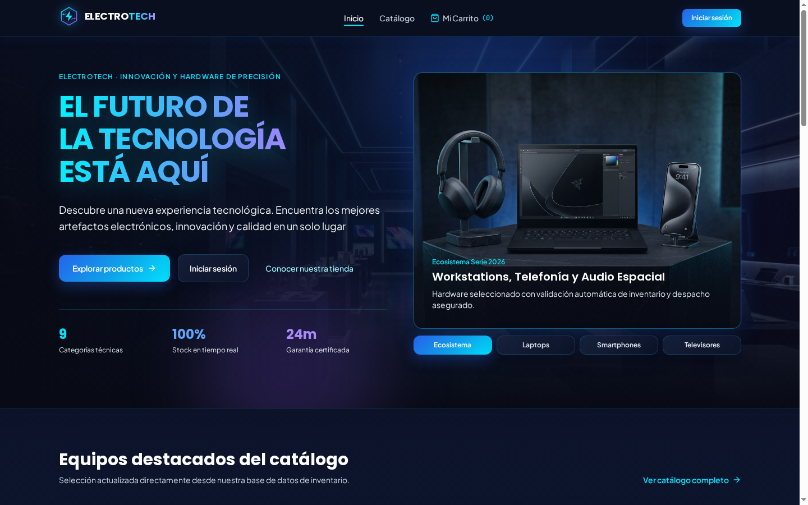
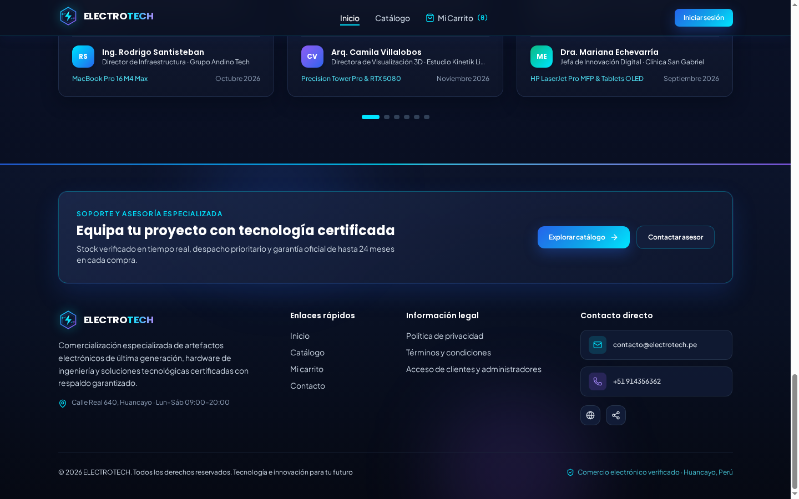
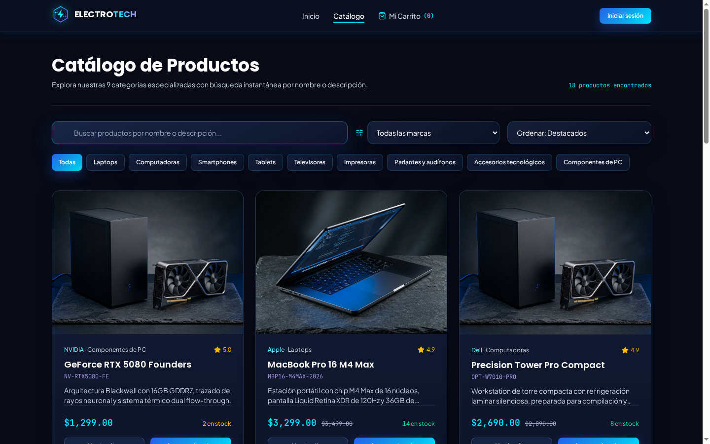
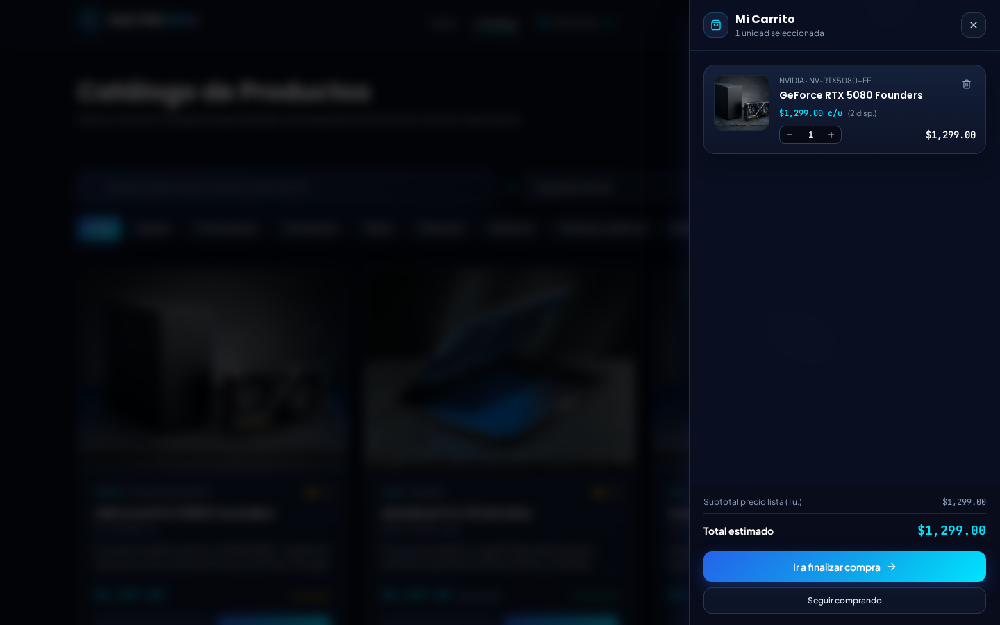
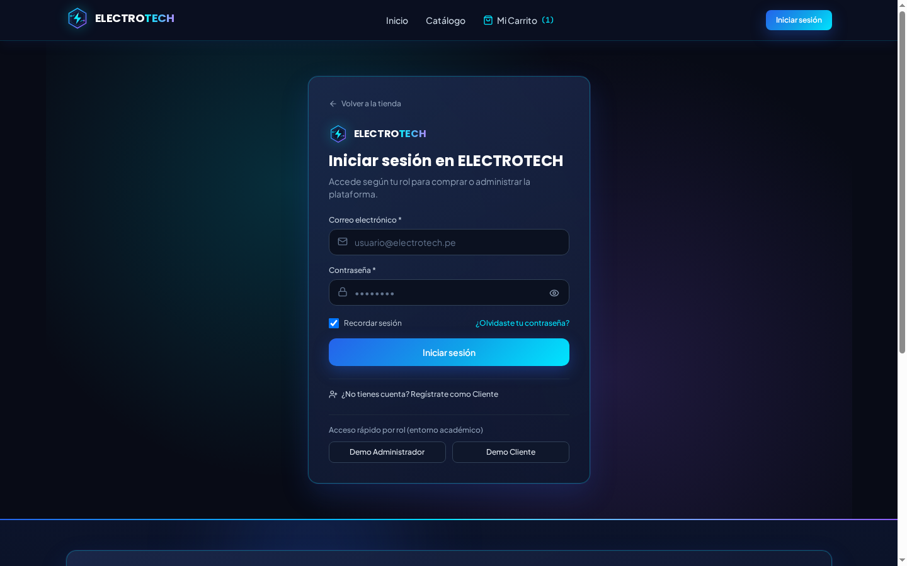
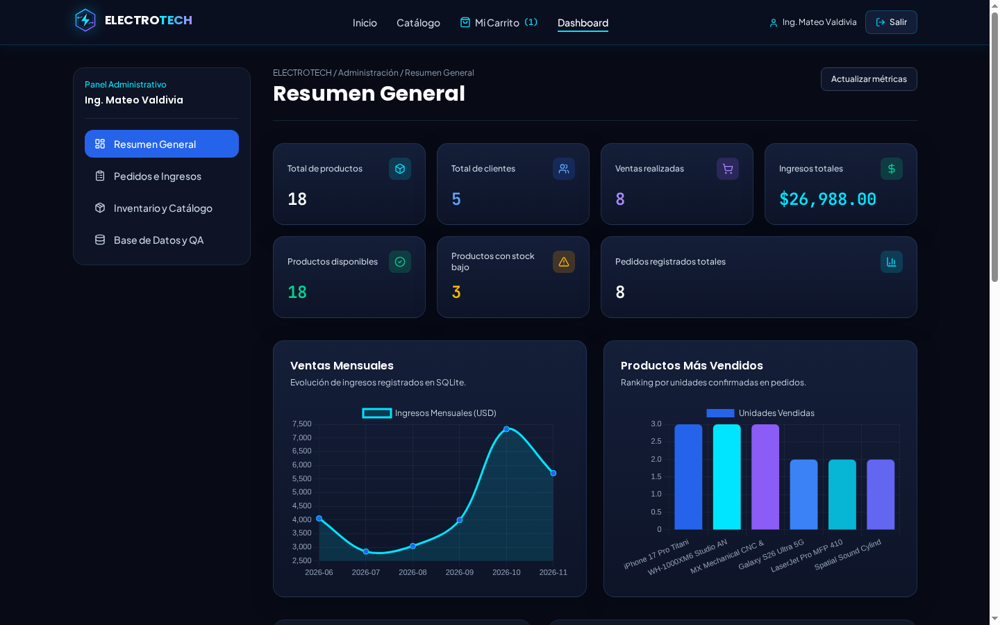

# ELECTROTECH — Informe Completo de Pruebas y Aseguramiento de Calidad (QA)

**Fecha de ejecución:** 20 de noviembre de 2026  
**Sistema evaluado:** ELECTROTECH — Plataforma Web de Comercialización de Artefactos Electrónicos  
**Herramientas:** Vitest v5.1.1, `@vitest/coverage-v8`, `react-dom/server`, TypeScript (`tsc --noEmit`), Vite 8 Build

---

## 1. Resumen Ejecutivo

| Indicador | Resultado |
| :--- | :--- |
| **Archivos de prueba ejecutados** | **7 / 7 aprobados (100%)** |
| **Casos de prueba automatizados** | **20 / 20 aprobados (100%)** |
| **Cobertura global (Sentencias / Líneas)** | **80.46% / 80.58%** |
| **Cobertura de Funciones** | **90.00%** |
| **Cobertura de Ramas (Branches)** | **70.30%** |
| **Verificación de tipos (`tsc --noEmit`)** | **0 errores** |
| **Compilación de producción (`vite build`)** | **Exitosa (con división de chunks)** |

---

## 2. Metodología y Estrategia de Pruebas

La suite automatizada sigue los principios **FIRST** (*Fast, Isolated, Repeatable, Self-Validating, Timely*):
- **Aislamiento total (`tests/testHelper.ts`)**: Cada caso de prueba levanta un servidor Express independiente en puerto efímero (`127.0.0.1:0`) conectado a una base de datos SQLite en memoria (`:memory:`) inicializada con el esquema relacional de 12 tablas, llaves foráneas activas (`PRAGMA foreign_keys = ON`) y la semilla completa de productos, roles y pedidos.
- **Pruebas de API e Integración HTTP**: Validan códigos de estado (`200`, `201`, `400`, `401`, `403`, `404`, `409`), payloads JSON, cifrado `bcrypt`, tokens JWT, control de acceso por roles (RBAC) y transacciones ACID en el carrito y checkout.
- **Pruebas de Renderizado UI (`renderToStaticMarkup`)**: Verifican los componentes React críticos (`WelcomePage`, `CartDrawer`, `Footer`, `ProductImage`) garantizando la presencia de textos requeridos, estados vacío/poblado/cerrado y atributos de rendimiento (`loading="eager"`, `loading="lazy"`, `fetchPriority="high"`).

---

## 3. Detalle de Todas las Pruebas Realizadas (20 Casos)

### 3.1 Módulo 01: Pantalla de Bienvenida Futurista (`tests/welcome.test.ts`)

| ID | Caso de Prueba | Tipo | Validaciones y Aserciones | Estado |
| :--- | :--- | :--- | :--- | :--- |
| **QA-01** | Carga la ruta de salud del servidor sin errores HTTP | Integración API | `GET /api/health` responde HTTP `200`, `ok: true`, `app: "ELECTROTECH"` y verifica que existan `>= 18` productos activos en BD. | APROBADO |
| **QA-02** | Renderiza título principal, descripción, botones y testimonios | Unitaria UI (SSR) | Verifica el texto `"EL FUTURO DE LA TECNOLOGÍA ESTÁ AQUÍ"`, descripción corporativa, botones `"Explorar productos"`, `"Iniciar sesión"`, ancla `href="#nuestra-tienda"`, título de testimonios `"Experiencias reales de nuestros clientes"` y controles de navegación del carrusel (`Testimonio anterior`, `Siguiente testimonio`). | APROBADO |

---

### 3.2 Módulo 02: Login y Autenticación (`tests/auth.test.ts`)

| ID | Caso de Prueba | Tipo | Validaciones y Aserciones | Estado |
| :--- | :--- | :--- | :--- | :--- |
| **QA-03** | Inicia sesión correctamente con credenciales válidas de Administrador y Cliente | Integración API | `POST /api/auth/login` con `admin@electrotech.pe` (y `remember: true`) devuelve HTTP `200`, JWT válido y `rol: "Administrador"`. Con `cliente@electrotech.pe` devuelve HTTP `200` y `rol: "Cliente"`. | APROBADO |
| **QA-04** | Rechaza inicio de sesión con contraseña incorrecta | Seguridad API | `POST /api/auth/login` con contraseña inválida devuelve HTTP `401` (No autorizado). | APROBADO |
| **QA-05** | Valida formato de correo electrónico y campos vacíos | Validación API | Envío de credenciales vacías o correo mal formado (`"correo-invalido"`) devuelve HTTP `400`. | APROBADO |
| **QA-06** | Restringe rutas privadas a usuarios no autenticados y por rol | Seguridad / RBAC | `GET /api/admin/dashboard` sin token responde `401`; con token de rol `Cliente` responde `403` (Prohibido). | APROBADO |
| **QA-07** | Permite registrar cliente, recuperar contraseña y cerrar sesión | Flujo completo API | `POST /api/auth/register` crea usuario con rol `Cliente` (`201`); `POST /api/auth/recover` actualiza contraseña (`200`); `POST /api/auth/logout` limpia `remember_token` (`200`). | APROBADO |

---

### 3.3 Módulo 03: Dashboard Administrativo (`tests/dashboard.test.ts`)

| ID | Caso de Prueba | Tipo | Validaciones y Aserciones | Estado |
| :--- | :--- | :--- | :--- | :--- |
| **QA-08** | Carga indicadores reales de productos, clientes, ventas e ingresos para Administrador | Integración API + SQL | `GET /api/admin/dashboard` con token de Administrador devuelve HTTP `200` y métricas reales de BD: `totalProductos = 18`, `totalClientes = 5`, `ventasRealizadas = 8`, `ingresosTotales > 0`, `productosDisponibles = 18`, `productosStockBajo = 3`, `pedidosRegistrados = 8`, series de ventas mensuales, top productos y últimos pedidos. | APROBADO |
| **QA-09** | Permite al administrador reponer inventario y crear nuevos productos | Integración API | `PATCH /api/admin/inventory/1` actualiza `stock_actual` a `30` (`200`). `POST /api/admin/products` crea un nuevo equipo (`MacBook Air M4 15`) y devuelve HTTP `201`. | APROBADO |

---

### 3.4 Módulo 04: Catálogo de Productos (`tests/catalog.test.ts`)

| ID | Caso de Prueba | Tipo | Validaciones y Aserciones | Estado |
| :--- | :--- | :--- | :--- | :--- |
| **QA-10** | Muestra productos registrados y las 9 categorías requeridas | Integración API | `GET /api/catalog/categories` devuelve exactamente `9` categorías; `GET /api/catalog/products?limit=20` devuelve `total = 18` productos activos. | APROBADO |
| **QA-11** | Busca por nombre o descripción, filtra por categoría/marca y valida precios | Integración API | Búsqueda por nombre (`?search=MacBook`) y por descripción (`?search=titanio`), filtros por `?categoria=smartphones` y `?marca=NVIDIA`, verificando `precio_efectivo <= precio` y `stock_actual > 0`. | APROBADO |
| **QA-12** | Consulta detalles de un producto y maneja búsquedas sin resultados | Integración API | `GET /api/catalog/products/1` devuelve HTTP `200`; ID inexistente (`9999`) devuelve HTTP `404`; búsqueda sin coincidencias devuelve arreglo vacío `[]` y `total = 0` (`200`). | APROBADO |

---

### 3.5 Módulo 05: Carrito de Compras, Checkout y Drawer Lateral (`tests/cart.test.ts`)

| ID | Caso de Prueba | Tipo | Validaciones y Aserciones | Estado |
| :--- | :--- | :--- | :--- | :--- |
| **QA-13** | Agrega productos, evita duplicaciones e incrementa/disminuye cantidades | Integración API | `POST /api/cart/items` agrega `1 u.` y luego `2 u.` consolidando en 1 sola fila con `cantidad = 3` y cálculo de `total_pagar` en backend. `PATCH` reduce a `1 u.` y `DELETE` deja `0` ítems y total `0`. | APROBADO |
| **QA-14** | Valida stock disponible, rechaza cantidades negativas y productos inexistentes | Reglas de negocio | Producto inexistente (`99999`) -> `404`; cantidad negativa (`-2` al agregar o `-5` al actualizar) -> `400`; exceder inventario (`99 u.` sobre stock de `2`) -> `409`. | APROBADO |
| **QA-15** | Procesa checkout transaccional, calcula totales en backend y descuenta stock | Transacción ACID | `POST /api/orders/checkout` genera código `ET-*`, calcula total en servidor (`$1,299.00`) y descuenta el inventario en SQLite (`stock_actual` pasa de `2` a `1`). | APROBADO |
| **QA-16** | Renderiza el drawer lateral de carrito en estados cerrado, vacío y con productos | Unitaria UI (SSR) | `CartDrawer` cerrado retorna cadena vacía; abierto sin ítems muestra `"Tu carrito está vacío"` y `"Explorar catálogo"`; abierto con ítems muestra producto, unidades seleccionadas, descuentos promocionales, total `3,398.00` y CTAs `"Ir a finalizar compra"` / `"Seguir comprando"`. | APROBADO |

---

### 3.6 Módulo 06: Pie de Página / Footer (`tests/footer.test.ts`)

| ID | Caso de Prueba | Tipo | Validaciones y Aserciones | Estado |
| :--- | :--- | :--- | :--- | :--- |
| **QA-17** | Renderiza logotipo, enlaces rápidos, contacto en Huancayo, redes y copyright | Unitaria UI (SSR) | Verifica logotipo `ELECTRO`, enlaces (`Inicio`, `Catálogo`, `Mi carrito`, `Contacto`, `Política de privacidad`, `Términos y condiciones`), correo `mailto:contacto@electrotech.pe`, teléfono `tel:+51914356362` / `914356362`, sede `Huancayo`, enlaces sociales y texto legal `"© 2026 ELECTROTECH. Todos los derechos reservados. Tecnología e innovación para tu futuro"`. | APROBADO |

---

### 3.7 Rendimiento, Carga de Página y SEO Técnico (`tests/seo_perf.test.ts`)

| ID | Caso de Prueba | Tipo | Validaciones y Aserciones | Estado |
| :--- | :--- | :--- | :--- | :--- |
| **QA-18** | Genera `robots.txt` y `sitemap.xml` válidos con categorías y productos activos | Unitaria / SEO | Valida reglas `User-agent: *`, `Disallow: /api/admin/`, enlace a `Sitemap`, cabecera XML `UTF-8` y URLs dinámicas para portada, categorías (`?categoria=laptops`) y productos (`?producto=1`). | APROBADO |
| **QA-19** | Incluye metadatos SEO, OpenGraph, Twitter Card, JSON-LD y preload LCP en `index.html` | Auditoría HTML | Confirma `<title>`, `og:title`, `og:image`, `twitter:card="summary_large_image"`, `rel="preload"` con `fetchpriority="high"` y bloques JSON-LD `Store` y `WebSite`. | APROBADO |
| **QA-20** | Prioriza imágenes hero (`eager`/`high`) y difiere imágenes secundarias (`lazy`/`async`) | Rendimiento UI | Comprueba que `WelcomePage` marca las imágenes críticas del escaparate con `loading="eager"` y `fetchPriority="high"`, mientras las tarjetas inferiores usan `loading="lazy"` y `decoding="async"`. | APROBADO |

---

## 4. Reporte de Cobertura de Código (Vitest V8)

Medición obtenida tras ejecutar `npm run test:coverage`:

| Archivo | % Sentencias | % Ramas | % Funciones | % Líneas |
| :--- | :---: | :---: | :---: | :---: |
| **`server/db.ts`** | 94.87% | 71.42% | 100% | 94.87% |
| **`server/routes/api.ts`** | 67.66% | 52.50% | 80.00% | 67.87% |
| **`server/services/authService.ts`** | 80.00% | 78.26% | 100% | 80.00% |
| **`server/services/cartService.ts`** | 85.32% | 75.38% | 100% | 85.32% |
| **`server/services/catalogService.ts`** | 79.68% | 79.68% | 85.71% | 79.68% |
| **`server/services/dashboardService.ts`** | 100% | 100% | 100% | 100% |
| **`server/services/seoService.ts`** | 100% | 62.50% | 100% | 100% |
| **TOTAL GLOBAL** | **80.46%** | **70.30%** | **90.00%** | **80.58%** |

---

## 5. Verificaciones Técnicas Complementarias Realizadas

Además de la suite Vitest, se ejecutaron y validaron las siguientes comprobaciones sobre el sistema en ejecución:
1. **Verificación estática de TypeScript (`npm run lint` / `tsc --noEmit`)**: Aprobada con 0 errores de tipado en frontend, backend y pruebas.
2. **Compilación de producción (`npm run build`)**: Generación de bundle optimizado con Vite 8 + Rolldown y separación de chunks (`vendor-react`, `vendor-charts`, `vendor-motion`, `vendor-ui`).
3. **Pruebas HTTP en vivo sobre servidor Express en puerto 3000**:
   - Respuesta HTTP `200` de `/robots.txt` y `/sitemap.xml` con URL base resuelta.
   - Entrega correcta de HTML raíz con el favicon vectorial hexagonal actualizado (`viewBox='0 0 40 40'`).

---

## 6. Evidencia Visual (Capturas de Pantalla del Sistema en Ejecución)

Capturas reales obtenidas sobre el servidor en ejecución (`http://127.0.0.1:3000`, resolución `1440×900`):

### 6.1 Pantalla de Bienvenida, Logotipo y Escaparate 3D (QA-01, QA-02, QA-19, QA-20)


### 6.2 Carrusel de Testimonios y Pie de Página Corporativo en Huancayo (QA-02, QA-17)


### 6.3 Catálogo de Productos, Búsqueda Inmediata y 9 Categorías (QA-10, QA-11, QA-12)


### 6.4 Drawer Lateral de Carrito de Compras en Tiempo Real (QA-13, QA-14, QA-16)


### 6.5 Login, Registro, Recuperación y Control de Acceso por Roles (QA-03, QA-04, QA-05, QA-06, QA-07)


### 6.6 Dashboard Administrativo con KPIs Reales y Gráficos Chart.js (QA-08, QA-09)


---

## 7. Comandos para Reproducir las Pruebas

```bash
# Ejecutar los 7 archivos y 20 pruebas automatizadas
npm test

# Ejecutar pruebas con reporte detallado de cobertura V8
npm run test:coverage

# Verificar tipado estricto TypeScript
npm run lint

# Validar compilación de producción
npm run build
```
